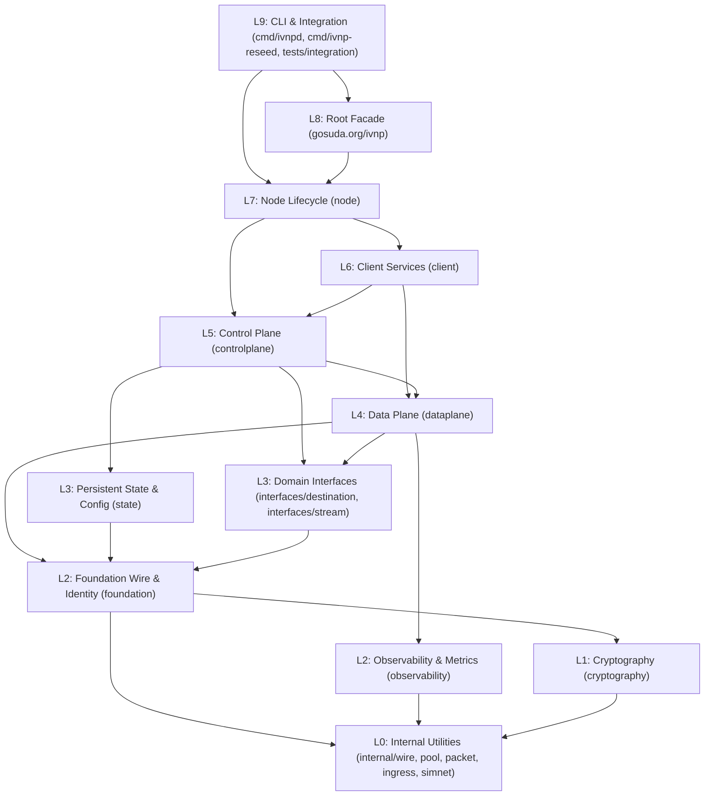

# IVNP Architecture & Design Invariants

IVNP is structured around a strict 10-layer unidirectional Directed Acyclic Graph (DAG), explicit separation between control policy and data execution, zero-allocation wire parsing, and deterministic resource lifetimes. Every architectural rule documented here is enforced by compile-time package visibility (`internal/`) or automated AST and `go list` tests in `architecture/architecture_test.go`.

---

## 1. Layered Dependency Hierarchy (L0 to L9)

Every package in `gosuda.org/ivnp` maps to a numeric layer (`0` through `9`) in `architecture/architecture_test.go` (`packageLayer`). A package at layer $L_i$ may import packages at layer $L_j$ only when $j \le i$. Upward imports ($j > i$) fail `TestImportLayersAreAcyclic`.

| Layer | Subsystem / Package Path | Core Responsibility | Permitted Internal Imports |
| :--- | :--- | :--- | :--- |
| **L9** | `cmd/ivnpd`, `cmd/ivnp-reseed`, `tests/integration` | Daemon binaries, standalone reseed indexer, and live integration tests | L0 through L8 |
| **L8** | `gosuda.org/ivnp` (root package) | Public embedded Go API (`Router`, `Destination`, `Dialer`, `PacketConn`, `UnauthPacketConn`) | L0 through L7 |
| **L7** | `node` | Coordinated startup and shutdown of `controlplane` and `client` services; multi-network `EmbeddedRouter` | L0 through L6 |
| **L6** | `client` | Client-facing protocols: SAM v3.3, HTTP/HTTPS-CONNECT proxy, SOCKS5 proxy, management control API, and AddressBook | L0 through L5 |
| **L5** | `controlplane` | NetDB (Kademlia XOR routing, floodfill), tunnel pool policy, STBM/VTBM building, destination publication, SU3 reseed, and NAT-PMP/UPnP | L0 through L4 |
| **L4** | `dataplane` | NTCP2 and SSU2 sessions, 1024-byte AES-256-CBC tunnel execution, ECIES-X25519-AEAD-Ratchet, I2P streaming, datagrams, and bounded queues | L0 through L3 (excluding `state`) |
| **L3** | `interfaces/destination`, `interfaces/stream`, `state` | Shared domain interfaces, INI configuration parser, and AES-256-GCM persistent state store | L0 through L2 |
| **L2** | `foundation`, `observability` | Identities, certificates, `Mapping`, I2NP framing, NetDB wire structures, atomic metrics registry, and health reporting | L0 through L1 |
| **L1** | `cryptography` | Stateless cryptographic primitives, constant-time $\mathbb{F}_{2^{255}-19}$ arithmetic, Elligator2, X25519, ML-KEM, ElGamal, Streebog, and `Sensitive` wiping | L0 |
| **L0** | `internal/{wire,pool,packet,ingress,parallelism,relay,simnet}` | Zero-allocation binary cursors, slab pools, packet buffers, panic recovery, worker sizing, stream relaying, and `simnet` virtual network | None (stdlib only) |



---

## 2. Subsystem Encapsulation & Canonical Imports

Each major subsystem (`cryptography`, `foundation`, `observability`, `state`, `dataplane`, `controlplane`, `client`, `node`) exposes a single root facade package (`<subsystem>/<subsystem>_subsystem.go`) and keeps its implementation packages inside `<subsystem>/internal/...`.

`architecture/architecture_test.go` enforces five structural invariants across every `.go` file in the module:

1. **No Cross-Subsystem Internal Bypass**: `subsystemInternalOwner` verifies that `<subsystem>/internal/...` is imported only by packages belonging to that same `<subsystem>`. External callers must import `gosuda.org/ivnp/<subsystem>`.
2. **Canonical Import Paths Without Aliases**: `TestPublicImportsUseCanonicalPathsWithoutAliases` parses every file's AST and rejects import aliases (`import cp "gosuda.org/ivnp/controlplane"`) on canonical subsystem root paths. Every subsystem exports unambiguous prefixed symbol names (such as `dataplane.TunnelCircuitToken` or `controlplane.NetworkDatabaseTable`) so aliases are never needed.
3. **Data Plane Isolation from Persistent State**: Even though `dataplane` (L4) sits above `state` (L3) numerically, `importViolation` explicitly forbids `dataplane` from importing `state`. All disk persistence and configuration loading stay in `controlplane` (L5) and `node` (L7).
4. **Unsafe Import Allowlist & Host-ABI Struct Layout**: `TestUnsafeImportsAreRestrictedAndABIStructsUseHostLayout` restricts `"unsafe"` imports in non-test files to `dataplane/internal/transport/ssu2/batch_linux_vector.go` (`recvmmsg`/`sendmmsg` vector I/O) and `state/internal/filesystem_store/secure_windows.go` (Windows DACL SIDs), and requires every fixed-size ABI struct in an unsafe file (`mmsghdr`) to embed `structs.HostLayout` as its leading field.
5. **Single Consolidated Import Block**: `tools/importformatter` enforces a single `import (...)` block per file, sorted into standard library and module groups.

---

## 3. Control Plane vs. Data Plane Separation

IVNP splits router operation into two distinct planes with strict ownership boundaries:

| Concern | Control Plane (`controlplane`, L5) | Data Plane (`dataplane`, L4) |
| :--- | :--- | :--- |
| **Peer & Destination Discovery** | Owns Kademlia `Database`, iterative `RequestManager` lookups, floodfill `StoreFlooder`, and `Explorer` | Never queries NetDB or resolves peer hashes |
| **Encrypted LeaseSet Resolution** | Computes daily blinded keys, fetches `EncryptedLeaseSet`, and runs `DecryptEncryptedLeaseSet` | Receives pre-resolved `PreparedRoute` snapshots containing decrypted target keys and leases |
| **Tunnel Lifecycle** | Selects diverse hops, constructs ECIES `ShortTunnelBuild` records, tracks 60s grace windows, and probes health | Executes in-place AES-256-CBC layer transforms, gateway fragmentation, and endpoint reassembly |
| **Transport Session Policy** | `TransportMux.Send` selects NTCP2 vs. SSU2, dials missing sessions, and seeds OBEPs with reply `RouterInfo`s | `EstablishedSender` and `DeliveryForwarder` transmit bulk frames strictly over already-established `PreparedSession` handles |
| **Cryptographic Session State** | Coordinates `ReserveRatchetReply` and `BeginSessionHandshake` to hold route rotation during handshakes | Owns `GarlicRatchetManager` tag windows, DH/symmetric ratchets, NTCP2 `SipState`, SSU2 `ACKTracker`, and streaming TCBs |

### Bulk Path vs. Control Path Transport Forwarding

A critical failure mode in overlay routers occurs when forwarding a bulk `TunnelData` frame or transit garlic clove blocks on an unestablished peer connection or triggers a recursive NetDB lookup. IVNP prevents this by splitting transport senders into two distinct types:

1. **`controlplane/internal/router.TransportMux`**: Used exclusively by control-plane operations (DHT queries, tunnel build requests, and initial session setup). If no viable NTCP2 or SSU2 session exists for the target peer, `TransportMux.Send` looks up the peer's `RouterInfo`, acquires a bounded handshake slot (`setupSlots`, capacity 64), and dials a transport session.
2. **`dataplane/internal/router.EstablishedSender` (`TransportMux.DataSender()`)**: Used by `tunnel.Runtime` and `DeliveryForwarder` for all transit and bulk tunnel traffic. `EstablishedSender` queries only live, already-authenticated NTCP2 or SSU2 sessions (`PreparedSession`). If no established session is present, the packet is dropped immediately without dialing or consulting NetDB.

---

## 4. Execution Lifetimes & Reference-Counted Circuit Draining

In I2P, tunnel IDs are 32-bit unsigned integers (`uint32`) chosen per hop. Relying on a raw `uint32` tunnel ID to manage circuit lifecycle creates an ABA hazard: if a tunnel expires or is replaced by a maintenance pass while a worker goroutine is midway through encrypting a packet or waiting on a send queue, a newly installed circuit or premature key wipe can corrupt in-flight state.

### `CircuitToken` and `circuitLifetime` (`dataplane/internal/tunnel/circuits.go`)

IVNP solves this with installation-scoped tokens and reference-counted draining:

```
InstallOutbound / InstallInbound / InstallParticipant
       │
       ▼
CircuitToken { id: uint32, generation: *circuitLifetime (refs = 1) }
       │
       ├──► Active packet acquires ref (refs.Add(1)) under shard RLock
       │    Shard RLock is released BEFORE AES-256-CBC transform & I/O
       │
       ├──► Policy replacement calls RemoveCircuitToken(token)
       │    Matches exact pointer (circuit.lifetime == token.generation)
       │    Marks circuit.retired = true and drops table ref (refs.Add(-1))
       │
       └──► In-flight packet finishes and calls circuit.release()
            When refs reaches 0:
            1. Zeroes all LayerCipher key schedules (ReleaseSensitive)
            2. Releases endpoint fragment reassembly slab leases
```

- **64-Way Sharded Circuit Table**: `tunnel.Runtime` partitions circuits across 64 `circuitShard` instances (`tunnelID & 63`). Workers hold `shard.mu.RLock()` only long enough to look up the circuit and increment `circuitLifetime.refs`. All AES-256-CBC layer encryption and network I/O run outside the shard lock.
- **Generation Matching**: `RemoveCircuitToken(token)` removes a table entry only if its internal `circuitLifetime` pointer matches `token.generation`. Stale teardown requests from a previous rotation cannot evict a newly installed circuit that happens to share the same numeric tunnel ID.
- **Destination Route Draining (`PreparedRouteSender`)**: In `dataplane/internal/router/prepared_routes.go`, outbound destination routes (`PreparedRoute`) are similarly reference-counted. When the control plane refreshes a destination's route snapshot (`InstallRoute`), in-flight sends complete on the old snapshot before its reference count drops to zero.

---

## 5. Control Ingress Isolation & Lookup Privacy

Inbound control messages (`DatabaseStore`, `DatabaseLookup`, `DatabaseSearchReply`, `TunnelBuild`, `VariableTunnelBuild`, `ShortTunnelBuild`, and their replies) require signature verification, gzip decompression, or X25519 Diffie-Hellman operations. Executing these handlers inline on transport receive workers would allow a burst of control traffic to stall SSU2 ACKs or NTCP2 frame reads.

### Bounded `ControlQueue` (`dataplane/internal/router/control_queue.go`)

Transport receive loops hand control messages to `ControlQueue`, which enforces two-tier admission budgets across both queued and actively executing messages:

- **Global Budget**: Up to `MaxItems = 256` messages and `MaxBytes = 4 MiB`.
- **Per-Source Budget**: Up to `MaxSourceItems = 32` messages and `MaxSourceBytes = 512 KiB` per authenticated peer hash (or a shared unauthenticated bucket for tunnel-delivered messages).
- **Execution-Spanning Accounting**: A message's byte and item reservations are released only *after* the worker goroutine finishes executing the control handler (`defaultControlHandlerTimeout = 30s`), preventing a single peer from exhausting worker threads with slow operations.

### Synchronous Lookup Privacy Tagging (`controlplane/internal/router/control_dispatch.go`)

When a router or local client destination issues an iterative `DatabaseLookup` for a remote `LeaseSet`, the reply arrives asynchronously as a `DatabaseStore` message. If that `DatabaseStore` sits in `ControlQueue` while the lookup's 3-second attempt timer expires, a naive handler inspecting lookup state *after* dequeueing would mistake the reply for an unsolicited floodfill publication and store it as public (`published = true`), allowing third-party peers to query which destinations the local node has contacted.

To prevent this leak:
1. `ControlDispatcher.Enqueue` calls `DatabaseStoreExpected(store)` **synchronously at ingress**, before placing the message into `ControlQueue`.
2. If any router or client `RequestManager` is awaiting that key, `incoming.PrivateStore` is set to `true` immediately.
3. When the worker eventually processes the message, `Database.HandleDatabaseStoreAsPublished(store, now, !incoming.PrivateStore)` records `published = false` in `leaseEntry`.
4. Floodfill `LookupResponder` queries `StoredPublishedLeaseSet(key, now)`, which filters out all `published == false` entries. Lookup-derived LeaseSets are usable for local outbound routes but are never re-served to the network.

---

## 6. Memory Discipline & Zero-Allocation Wire Codecs

### Zero-Copy Parsing and Fixed-Capacity Serialization (`internal/wire/cursor.go`)

All binary parsers in `foundation`, `dataplane`, and `controlplane` are built on `wire.Cursor` and `wire.Writer`:

- **`wire.Cursor`**: Wraps a caller-owned `[]byte` slice with an integer offset. `ReadU8`, `ReadU16`, `ReadU32`, `ReadU64`, and `ReadBytes(n)` bounds-check against `len(buf) - off` and return subslices (`buf[start:off]`) directly without heap allocation.
- **`wire.Writer`**: Wraps a caller-provided fixed-capacity destination slice `dst`. `PutU8`..`PutU64`, `Put`, and `Reserve(n)` write directly into `dst[off : off+n]` and return `ErrShortBuffer` if capacity is exceeded; `Writer` never calls `append` or grows backing arrays on the heap.
- **Structural Parse Before Signature Verification**: In `foundation/internal/netdb`, `ParseRouterInfo`, `ParseLeaseSet2`, `ParseEncryptedLeaseSet`, and `ParseMetaLeaseSet` validate wire layout, canonical option sorting (`ValidateCanonical`), and field bounds in zero allocations *before* any signature verification runs. Callers check cheap admission predicates (`netId`, freshness timestamps, duplicate versions) before paying for Ed25519, RedDSA, or RSA verification.

### Power-of-Two Slab Pooling (`internal/pool/slab.go` & `internal/packet/buffer.go`)

- **`pool.Lease`**: Manages 9 power-of-two `sync.Pool` size classes from $2^8$ (`256 B`) through $2^{16}$ (`65,536 B`). Rather than pooling raw `[]byte` values (which allocate a 24-byte slice header on the heap when boxed into `any`), `leaseSlabs` pools `*pool.Lease` struct pointers.
- **`Lease.ReleaseSensitive()`**: Calls `clear(l.buf[:cap(l.buf)])` over the full backing slab before returning the lease to the pool.
- **`packet.Buffer`**: Single-owner packet buffer combining a pooled `Buffer` struct with a `pool.Lease`. Pre-reserves leading headroom (`reserved`) so transport and tunnel layers can prepend framing headers via `Push(n)` and append payloads via `Append(n)` without copying or reallocating.

### Explicit Cryptographic Wiping (`cryptography/sensitive.go`)

Every stateful key or cipher holder implements `cryptography.Sensitive`:

```go
type Sensitive interface {
	ReleaseSensitive()
}
```

- **`X25519PrivateKey` (`cryptography/x25519.go`)**: Stores only a raw `[32]byte` scalar. During `ECDH` or `PublicKey`, it constructs a short-lived `crypto/ecdh.PrivateKey`, copies the output into caller storage, and immediately calls `clear(secret)` on the intermediate slice returned by stdlib. Calling `ReleaseSensitive()` zeroes the `[32]byte` scalar and marks the key released (`ErrSensitiveReleased`).
- **`MLKEMPrivateKey` (`cryptography/mlkem.go`)**: Stores only the 64-byte FIPS-203 seed (`[mlkem.SeedSize]byte`), reconstructing the decapsulation key on demand and zeroing intermediate buffers after each decapsulation.
- **`ChaCha20Poly1305` (`cryptography/chacha.go`)**: Zeroes the 32-byte key array and drops the inner `cipher.AEAD` reference on `ReleaseSensitive()`.

---

## 7. Fault Isolation at Ingress Boundaries (`internal/ingress/recover.go`)

Network-facing workers must never allow an unhandled panic in a single packet or connection to crash the router process. `internal/ingress` defines seven explicit recovery boundaries:

| Boundary Constant | ID | Protected Execution Path |
| :--- | :--- | :--- |
| `BoundaryNTCP2Handshake` | `1` | Inbound and outbound NTCP2 Noise XK handshake goroutines |
| `BoundaryNTCP2Frame` | `2` | Established NTCP2 session frame read/dispatch loops |
| `BoundarySSU2Packet` | `3` | SSU2 UDP batch read, setup, auth, and dispatch workers |
| `BoundaryClientConnection` | `4` | SOCKS5 and client stream relay connections |
| `BoundaryHTTPHandler` | `5` | HTTP proxy, control server, observability, and WebUI HTTP handlers |
| `BoundarySAMUDP` | `6` | SAM v3.3 UDP datagram ingress worker (`127.0.0.1:7655`) |
| `BoundarySAMWorker` | `7` | SAM v3.3 TCP control, `STREAM CONNECT`, and `STREAM ACCEPT` workers |

When a boundary catches a panic via `defer ingress.Recover(&err, reporter, boundary, peer)`, it converts the panic into `ErrRecoveredPanic`, captures the runtime stack trace (`debug.Stack()`), increments the observability panic counter (`ReportRecoveredPanic`), and terminates only the offending connection or packet handler.

---

## 8. Durable Encrypted State & Tainted-Copy Fallback (`state`)

Persistent router identity and destination keys are managed by `state/internal/secure_store` and `state/internal/filesystem_store`:

1. **AES-256-GCM Envelope (`router.state`)**:
   - The 32-byte master key lives in `router.keys` (`0600` permissions) and is wiped from memory (`clear(key)`) immediately after each `Load` or `Save`.
   - `router.state` begins with a 17-byte header: `magic[4] ("IVNP") || version[1] (0x02) || nonce[12]`.
   - The serialized `Bundle` (router Ed25519/X25519 keys, NTCP2 static key/IV, SSU2 static/intro keys, and named destination private keys and `EncryptedLeaseSet` policies) is encrypted with AES-256-GCM using `"IVNP\x02"` as Additional Authenticated Data (AAD).
   - On both `Load` and `Save`, `validateBundle` verifies cryptographic consistency across every keypair (including a live round-trip `EncryptElGamal`/`DecryptElGamal` check for legacy destinations) before accepting the bundle.
2. **Symlink-Safe Atomic Writes (`filesystem_store`)**:
   - On Unix, files are opened with `O_NOFOLLOW | O_NONBLOCK`, verified to be regular files owned by `os.Getuid()` with `stat.Nlink == 1` (rejecting hard links) and `0600` permissions (`0700` for directories).
   - On Windows, files are opened with `FILE_FLAG_OPEN_REPARSE_POINT` to detect and reject reparse points/junctions, alternate data streams (`:`), and multi-link files, and are created with an owner-only protected DACL (`D:P(A;OICI;FA;;;<owner-sid>)`).
   - All updates write to a random `.ivnp-<hex>` temporary file, `fsync` the file, atomically rename it over the target, and `fsync` the parent directory.
3. **Advisory Locking & Tainted-Copy Promotion**:
   - `Store.AcquireLock()` acquires a non-blocking exclusive OS lock (`flock(LOCK_EX|LOCK_NB)` on Unix, `LockFileEx` on Windows) on `.ivnp.lock`.
   - If another process holds `.ivnp.lock` and `TaintedCopy` is enabled, `controlplane.Controller` clones the state into an isolated `0700` temporary directory (`ivnp-tainted-*`) with fresh ephemeral router transport keys so the node can boot immediately. A background loop (`masterLockRetryLoop`, default every `15s`) polls `.ivnp.lock` and promotes the running node to master in place once the lock becomes free.
