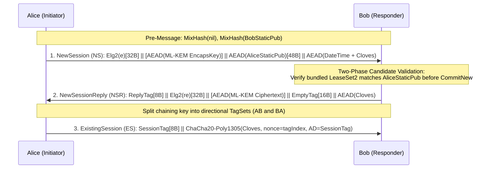
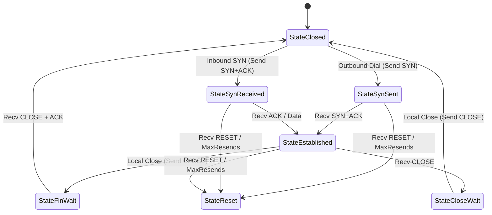

# Garlic, Streaming & Datagrams

This document specifies IVNP's end-to-end destination protocols in Layer L4 (`dataplane`): the `ECIES-X25519-AEAD-Ratchet` session engine (including post-quantum ML-KEM hybrids), the I2P Streaming protocol (`Protocol 6`), and the four I2P Datagram protocols (`Protocols 17..20`).

---

## 1. ECIES-X25519-AEAD-Ratchet (`dataplane/internal/garlic`)

End-to-end garlic sessions between destinations (and anonymous Noise-N garlic wrappers between routers) are implemented in `dataplane/internal/garlic/ecies` and coordinated by `dataplane/internal/garlic`.

### 1.1 Supported Handshake Suites (`handshake.go`, `hybrid.go`)

| LeaseSet2 Key Type | Suite Constant | Noise Protocol Name |
| :--- | :--- | :--- |
| `4` (`CryptoX25519`) | Standard ECIES | `Noise_IKelg2+hs2_25519_ChaChaPoly_SHA256` |
| `6` (`CryptoMLKEM768X25519`) | PQ Hybrid 768 | `Noise_IKhfselg2+hs2_25519+MLKEM768_ChaChaPoly_SHA256` |
| `7` (`CryptoMLKEM1024X25519`) | PQ Hybrid 1024 | `Noise_IKhfselg2+hs2_25519+MLKEM1024_ChaChaPoly_SHA256` |

### 1.2 Handshake Message Formats: New Session (NS) & New Session Reply (NSR)



1. **New Session (`NS`)**:
   - Alice generates an Elligator2-encodable X25519 ephemeral keypair (`GenerateElligator2X25519`), writes the 32-byte representative `elg2`, calls `MixHash(elg2)`, and mixes `ECDH(e, rs)`.
   - For post-quantum hybrid suites (`HybridInitiator`), Alice generates an ephemeral FIPS-203 ML-KEM encapsulation key (`1184B` for ML-KEM-768, `1568B` for ML-KEM-1024) and encrypts it with `EncryptAndHash`.
   - **Static Key Section (48 bytes)**: For bound sessions, Alice encrypts her 32-byte static X25519 public key (`s`) and mixes `ECDH(s, rs)`. For unbound one-shot messages (`BuildUnboundNewSession`), Alice encrypts 32 zero bytes without performing a second DH.
   - **Payload Section**: Encrypted via `EncryptAndHash`. `ParseNewSession` enforces that the payload begins with a 7-byte `BlockDateTime` (`0x00`) within `-300s..+120s` of local clock time.
2. **New Session Reply (`NSR`)**:
   - From the NS chaining key `ck`, Bob derives an 8-byte `ReplyTag` via `HKDF(ck, "", "SessionReplyTags")` followed by `HKDF(tagSetKey, "", "SessionTagKeyGen")[:8]`.
   - Bob calls `MixHash(replyTag)`, writes his 32-byte Elligator2-encoded ephemeral public key `re`, calls `MixHash(re)`, and mixes `ECDH(re, e)`.
   - For post-quantum hybrid suites, Bob encapsulates against Alice's ML-KEM key, encrypts the ciphertext (`1088B` or `1568B`) via `EncryptAndHash`, and calls `MixKey(kemSharedSecret)`.
   - Bob mixes `ECDH(re, s)`, writes a 16-byte empty key-section tag (`EncryptAndHash(nil)`), splits the chaining key via `splitWithRoot` into `(splitRoot, abKey, baKey)`, and seals the NSR payload with a key derived via `HKDF(baKey, "", "AttachPayloadKDF")` using the handshake hash `h` as AD.

### 1.3 Two-Phase Inbound `NewSession` Commit & Reply Ordering Gate

A subtle vulnerability in naive ECIES implementations occurs if an unauthenticated or replayed `NewSession` packet immediately overwrites an active peer session or pollutes the global tag table before the sender's identity is verified. IVNP prevents this with two mechanisms in `dataplane/internal/garlic/ecies/ratchet.go` and `dataplane/internal/router/data_plane.go`:

1. **Two-Phase `NewSessionCandidate`**:
   - `ReceiveNewSessionCandidate` decrypts the inbound `NewSession` and verifies its `DateTime` block **without mutating any session or tag table state**.
   - `GarlicReceiver` inspects the decrypted garlic cloves (`pendingCloves`, up to 16) for a bundled `DatabaseStore` carrying the peer's `LeaseSet2`.
   - Only after `leaseSetMatchesRatchetStatic` confirms that the signed `LeaseSet2` advertises the exact X25519 static key from the NS handshake does `GarlicReceiver` invoke `CommitNew(candidate)` (or `RetainNew(candidate)` if the `LeaseSet2` must be matched against an existing entry).
2. **Inbound Reply Ordering Gate (`ReserveInboundReply` / `ReserveRatchetReply`)**:
   - When an inbound NS commits and requires a `NewSessionReply`, `ReserveInboundReply` installs a reservation gate (`ratchetReplyHoldTimeout = 5s`).
   - Any concurrent outbound application packets for that peer wait on `gate.done` until the NSR frame has been dispatched (`ReleaseRatchetReply: true`), guaranteeing that the remote initiator receives the NSR handshake completion before receiving `ExistingSession` tags derived from it.

### 1.4 Symmetric & DH Ratchets and Single-Use Tag Consumption (`ratchet.go`, `ratchet_window.go`)

- **TagSet Initialization (`newTagSet`)**: Derives `rootKey` and `tagKey` via `"KDFDHRatchetStep"`, then `"TagAndKeyGenKeys"` and `"STInitialization"` to produce `(nextRoot, tagChain, tagConstant, keyChain)`.
- **Per-Message Ratchet (`deriveEntry`)**: Advances `tagChain` with `"SessionTagKeyGen"` to produce an 8-byte `SessionTag`, and steps `keyChain` with `"SymmetricRatchet"` to produce a 32-byte message key (`ChaCha20-Poly1305` with 12-byte nonce `0x00000000 || LE64(index)` and the 8-byte tag as AD).
- **Bounded Circular Receive Window (`receiveTags`)**: Pre-derives tags into a fixed-capacity ring (`DefaultTagLookahead = 512`, `capacity = 2*lookahead + 1 = 1025`) bounded by `defaultMaxTags = 8192` per manager.
- **Single-Use Tag Consumption**: When an `ExistingSession` packet matches an 8-byte tag in `Open`, the tag is **removed from the lookup index before AEAD tag verification runs**. If the ciphertext is corrupted or tampered with, the packet fails immediately and can never be replayed or fall through to Elligator2 `NewSession` trial decryption.
- **Automatic DH Ratchet (`NextKey` block `0x07`)**: Initiated automatically after `automaticDHRatchetMessages = 4096` messages (or on explicit `RequestDH`), exchanging fresh X25519 keys (`XDHRatchetTagSet`) and keeping the replaced inbound tagset alive for `previousSetLife = 3m` to absorb reordered packets.
- **Sharded `RatchetManager` (`garlic/ratchet.go`)**: Partitions peer sessions across `parallelism.Workers(maxSessions)` shards while maintaining a 64-way sharded tag index (`tagShards [64]ratchetTagShard`) via `TagObserver` callbacks so inbound 8-byte tag lookups route directly to the owning shard.

### 1.5 One-Time Reply Tags, Router Garlic & I2CP Gzip Framing

- **`ReplyKeyRegistry` (`reply_keys.go`, `one_time_reply.go`)**: Stores up to `4096` single-use `(8B tag, 32B key)` pairs (`TTL = 2m`) for encrypted `DatabaseLookup` and `ShortTunnelBuild` replies. `OpenOneTimeReplyExistingSession` opens the reply with zero nonce and the 8-byte tag as AD, permitting only `DatabaseStore`, `DatabaseSearchReply`, `TunnelBuildReply`, and `ShortTunnelBuildReply` cloves.
- **Anonymous Router Garlic (`router_message.go`)**: Encrypts router-to-router garlic cloves (such as paired inbound tunnel builds sent to an IBGW) using one-shot `Noise_N_25519_ChaChaPoly_SHA256` (`SealRouterMessage` / `OpenRouterMessage`, `routerMessageMaxSkew = 5m`).
- **I2CP 10-Byte Gzip Payload Framing (`dataplane/internal/router/data_plane.go`)**: Application payloads carried inside destination `I2NPData` (type 20) cloves are wrapped in the standard 10-byte I2CP header (`flags[1] || fromPort[2, BE] || toPort[2, BE] || protocol[1] || gzipPayload`), verifying CRC32 and uncompressed `ISIZE` (`foundation.I2NPI2PDMaxPayload = 65535`).

---

## 2. I2P Streaming Protocol (`dataplane/internal/streaming`)

I2P Streaming (`ProtocolStreaming = 6`) provides reliable, ordered, congestion-controlled byte streams (`net.Conn` and `net.Listener`) over destination garlic sessions.

### 2.1 22-Byte Streaming Packet Wire Format (`packet.go`, `encode.go`)

```
Offset   0                   4                   8                   12
         ┌───────────────────┬───────────────────┬───────────────────┬───────────────────┐
         │ SendStreamID (4B) │ RecvStreamID (4B) │ SequenceNum (4B)  │ AckThrough (4B)   │
         ├─────────┬─────────┴───────────────────┴─────────┬─────────┼───────────────────┤
         │NACKCnt1B│ NACKs (4B × NACKCount)                │ResendDly│ Flags (2B, BE)    │
         ├─────────┴─────────┬─────────────────────────────┴─────────┴───────────────────┤
         │ OptionsLen(2B,BE) │ Options (Variable, Canonical Order)   │ Payload (<=3050B) │
         └───────────────────┴───────────────────────────────────────┴───────────────────┘
```

#### Flags & Canonical Option Order

Options are serialized and parsed in bit-order of the `Flags` field (`MaxPacketSize = 3072`, `HeaderLen = 22`):

| Flag Bit | Mask | Constant | Option Wire Field (If Present) |
| :--- | :--- | :--- | :--- |
| Bit 0 | `0x0001` | `FlagSynchronize` | None (initiates stream) |
| Bit 1 | `0x0002` | `FlagClose` | None (graceful half-close / FIN) |
| Bit 2 | `0x0004` | `FlagReset` | None (abrupt termination / RST) |
| Bit 3 | `0x0008` | `FlagSignatureIncluded` | `Signature[sigLen]` (last field in options; computed with signature bytes zeroed) |
| Bit 5 | `0x0020` | `FlagFromIncluded` | `From[Identity.EncodedLen()]` |
| Bit 6 | `0x0040` | `FlagDelayRequested` | `DelayRequested[2B, BE]` |
| Bit 7 | `0x0080` | `FlagMaxPacketSize` | `MaxPacketSize[2B, BE]` (default local `3050`, peer fallback `1730`, min `512`) |
| Bit 10 | `0x0400` | `FlagNoACK` | None (`AckThrough` field ignored) |
| Bit 11 | `0x0800` | `FlagOfflineSignature` | `Expires[4B] \|\| TransientType[2B] \|\| TransientPubKey \|\| MasterSig` |

### 2.2 SYN Target-Hash Replay Protection (`tunnel/tunnel.go`)

Because a `SYN` packet carries the initiator's `From` identity and signature, a malicious destination could replay an intercepted `SYN` packet to a third destination unless the signature binds the intended recipient. Per the I2P streaming specification:

- When building an outbound `SYN` (`SendStreamID == 0`), `hashToNACKs(targetHash)` packs the 32-byte `foundation.Hash` of the remote destination into **8 four-byte NACK words** (`NACKCount = 8`) before signing the packet.
- On the responder, `nacksMatchHash(pkt.NACKs, localHash)` verifies that an inbound `SYN` contains the local destination's exact 32-byte hash in its NACK list and verifies the control signature (`verifyControl`, supporting `OfflineSignature` via `verifyTransient`) before allocating a stream.
- Inbound `SYN` processing acquires a bounded concurrency token (`synTokens`, `maxInboundSYNPrep = 8`) and notifies `HandshakeObserver` (`BeginSessionHandshake` / `EndSessionHandshake`) so the control plane holds tunnel rotation steady while the handshake completes.

### 2.3 TCB State Machine, RTO, Congestion Control & Pacing (`state.go`, `reliability.go`, `tunnel.go`)



- **Jacobson/Karels `RTOEstimator`**: `InitialRTO = 9s`, `MinRTO = 100ms`, `MaxRTO = 60s`. `Observe(rtt, retransmitted)` ignores retransmitted packets (Karn's rule) and updates `SRTT`, `RTTVAR`, and `RTO = clamp(SRTT + 4*RTTVAR, 100ms, 60s)`. Timeout expiration doubles `RTO` up to `60s`.
- **`CongestionWindow`**: `InitialWindow = 3` packets, `MinWindow = 1`, `MaxWindow = 128`, `MaxResends = 8`. Grows by `1` packet per ACK during slow start (`cwnd < ssthresh`) and by `1/cwnd` during congestion avoidance; on 3-NACK fast retransmit (`FastRecovery()`), sets `ssthresh = max(cwnd/2, 1)` and `cwnd = ssthresh`, whereas RTO timeout expiration (`Loss()`) sets `ssthresh = max(cwnd/2, 1)` and resets `cwnd = 1`.
- **Selective NACKs & Fast Retransmit**: Out-of-order packets within `MaxWindow = 128` of `recvNext` are buffered in `reordered`. Outbound ACKs list all missing sequence numbers between `recvNext` and the highest buffered packet in the `NACKs` array. When an unacknowledged outbound packet accumulates `3` NACK reports (`pending.nacks == 3`), `maintain()` triggers an immediate fast retransmit and enters `FastRecovery()` without waiting for the RTO timer.
- **Min-Heap Send Pacing**: Rather than bursting a full window into a tunnel at once, `maintain()` schedules outbound packets on a min-heap (`sendSchedule`) spaced by `clamp(RTO / (cwnd * 8), 250µs, 10ms)` and coalesces pure ACKs for `ackHoldInterval = 50ms`.

---

## 3. I2P Datagram Protocols (`dataplane/internal/datagram`)

IVNP supports all four I2P datagram protocols (`MaxSendDatagramSize = 32768`, `MaxReceiveDatagramSize = 62690`):

| Protocol Number | Name | Root Constructor | Source Identity | Signature & Replay Properties |
| :--- | :--- | :--- | :--- | :--- |
| `17` | **Datagram1** (`V1`) | `Destination.ListenPacket` (`*PacketConn`) | Full `Identity` (`391+` B) | Signs `Payload` directly (or `SHA256(Payload)` for legacy DSA-SHA1). Does **not** bind recipient hash; vulnerable to cross-destination replay. |
| `18` | **Raw** (`Raw`) | `Destination.ListenUnauthPacket` (`*UnauthPacketConn`) | None (`0` B overhead) | Zero header, unauthenticated payload. |
| `19` | **Datagram2** (`V2`) | `Destination.ListenPacket` (`*PacketConn`) | Full `Identity` (`391+` B) | Signs `targetDestHash[32] \|\| Flags[2] \|\| [Options] \|\| [OfflineSig] \|\| Payload`. Prevents cross-destination replay and supports offline transient keys. |
| `20` | **Datagram3** (`V3`) | `Destination.ListenUnauthPacket` (`*UnauthPacketConn`) | 32-byte `Hash` (`34+` B) | Unsigned at datagram layer; relies on the underlying `ECIES-X25519-AEAD-Ratchet` session for source authentication. |

### `Datagram2` (Protocol 19) Wire Layout (`modern.go`)

```
┌───────────────────────────┬──────────────────┬──────────────────┬──────────────────┬─────────┬───────────┐
│ From Identity (391+ B)    │ Flags (2B, BE)   │ [Options]        │ [OfflineSig]     │ Payload │ Signature │
│                           │ Low nibble = 0x2 │ If flags & 0x10  │ If flags & 0x20  │         │ (64B Ed)  │
└───────────────────────────┴──────────────────┴──────────────────┴──────────────────┴─────────┴───────────┘
```

When `PacketConn` receives a `Datagram2` delivery, `V2.VerifyTargetAt(localDestinationHash, time.Now())` reconstructs the preimage prefixed with the local destination's 32-byte `Hash`, checks any `OfflineSignature` expiration against current time, verifies the signature, and confirms that `V2.From.Hash() == delivery.From`.
