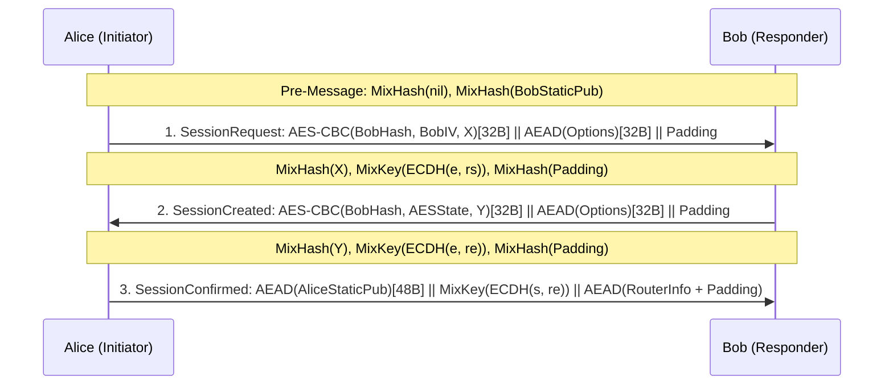

# Transports & Tunnels

This document details IVNP's point-to-point transport protocols (**NTCP2** over TCP and **SSU2** over UDP) and its multi-hop tunnel subsystem (1024-byte layered AES-256-CBC execution, gateway fragmentation, endpoint reassembly, and ECIES-X25519 tunnel building).

---

## 1. Noise XK Handshake Engine (`dataplane/internal/transport/noise`)

Both NTCP2 and SSU2 build on `noise.SymmetricState` (`dataplane/internal/transport/noise/state.go`), which implements the Noise Framework symmetric state machine over `ChaCha20-Poly1305` and `SHA-256`:

- **`Initialize(protocolName)`**: Sets `h = pad32(protocolName)` if `len(protocolName) <= 32`, else `SHA256(protocolName)`. Sets `ck = h` and `nonce = 0`.
- **`MixHash(data)`**: Updates `h = SHA256(h || data)`.
- **`MixKey(dhOutput)`**: Runs 2-output HKDF-SHA256 (`kdf2(ck, dhOutput)`), updates `ck`, initializes `ChaCha20Poly1305` with the derived 32-byte cipher key, and resets `nonce = 0`.
- **`EncryptAndHash(dst, plaintext)` / `DecryptAndHash(dst, ciphertext)`**: Seals or opens with a 12-byte nonce (`0x00000000 || LE64(nonce)`) and `h` as Associated Data (AD), mixes the ciphertext into `h`, and increments `nonce`.

---

## 2. NTCP2 Transport (`dataplane/internal/transport/ntcp2`)

NTCP2 provides authenticated, length-obfuscated TCP transport using `Noise_XKaesobfse+hs2+hs3_25519_ChaChaPoly_SHA256`.

### 2.1 Three-Flight Noise XK Handshake (`handshake.go`)



1. **Message 1 (`SessionRequest`)**:
   - Alice generates an X25519 ephemeral key `X` (32 bytes) and encrypts it in place using AES-256-CBC with Bob's 32-byte router identity hash as the key and Bob's published 16-byte `i` option (`remoteIV`) as the IV. The second 16-byte ciphertext block (`dst[16:32]`) is retained as `aesState` for Message 2.
   - When `checkLegacyPadding` is enabled, Alice rejects padding lengths that would produce a total Message 1 length of exactly `288` bytes (`LegacyNTCPMaxSessionRequestLen + 1`), preventing ambiguity with legacy NTCP1.
   - Alice calls `MixHash(X)` and `MixKey(ECDH(e, rs))`, encrypts the 16-byte `SessionRequestOptions` (`NetworkID`, `Version = 2`, `PaddingLength`, `Message3Part2Length`, `Timestamp` in seconds) into `dst[32:64]`, appends cleartext `padding`, and calls `MixHash(padding)`.
2. **Message 2 (`SessionCreated`)**:
   - Bob decrypts `X`, checks `(X)` against the 4096-entry ephemeral replay ring (`ntcp2_manager.go`), verifies `NetworkID` and clock skew (`±120s`), and reads `PaddingLength` bytes of padding.
   - Bob generates ephemeral key `Y`, calls `MixHash(Y)` and `MixKey(ECDH(e, re))`, encrypts `Y` with AES-256-CBC using Bob's router hash and `aesState` as the IV, encrypts `SessionCreatedOptions` into `dst[32:64]`, appends `padding`, and calls `MixHash(padding)`.
3. **Message 3 (`SessionConfirmed`)**:
   - **Part 1 (48 bytes)**: Alice encrypts her 32-byte static X25519 public key (`s`) under the Message 2 cipher key at `nonce = 1`.
   - Both sides compute `MixKey(ECDH(s, re))`.
   - **Part 2 (`Message3Part2Length` bytes)**: Alice encrypts her payload frame (which must begin with `BlockRouterInfo` containing her signed `RouterInfo`) at `nonce = 0`.

### 2.2 Data Phase & SipHash-2-4 Frame Length Masking (`frame.go`, `session.go`)

After Message 3 completes, `newDataSession` splits the chaining key into directional ChaCha20-Poly1305 keys (`kab`, `kba`) and derives directional SipHash-2-4 states (`sipAB`, `sipBA`) via `askMaster = HMAC-SHA256(temp, "ask" || 0x01)` and `"siphash"`:

- Each data frame on the TCP stream is preceded by a 2-byte big-endian ciphertext length (`16..65535`).
- Before sending (and upon receiving), `SipState` advances `iv = sipHash24(k0, k1, iv)` and XORs the 2-byte length with `uint16(iv)`.
- Inside the AEAD plaintext (`MaxPlaintextFrame = 65519` bytes), `BlockIterator` parses TLV blocks (`1B type || 2B length || data`): `BlockDateTime (0)`, `BlockOptions (1)`, `BlockRouterInfo (2)`, `BlockI2NP (3)` (carrying a 9-byte transport I2NP header + payload), `BlockTermination (4)`, and `BlockPadding (254)` (which must be the final block in a frame).

### 2.3 Connection Management & Crossed-Dial Resolution (`ntcp2_manager.go`)

`NTCP2Manager` deduplicates concurrent outbound dials to the same peer hash (`dialing` map) and enforces `defaultNTCP2MaxSessions = 256` and `defaultNTCP2MaxPending = 64`. If two routers dial each other simultaneously, `preferInboundSession(local, peer)` compares the 32-byte router hashes lexicographically so both peers deterministically retain the same connection and close the duplicate.

---

## 3. SSU2 Transport (`dataplane/internal/transport/ssu2`)

SSU2 is a UDP transport built on `Noise_XKchaobfse+hs1+hs2+hs3_25519_ChaChaPoly_SHA256` with ChaCha20 header encryption, selective ACK tracking, RFC 6298 retransmission, dynamic MTU discovery, 7-message peer testing, and introducer-assisted NAT hole punching.

### 3.1 Wire Headers & Dual-ChaCha20 Header Protection (`packet.go`, `token.go`)

SSU2 uses a 16-byte `ShortHeader` for `Data (6)` and `SessionConfirmed (2)` packets, and a 32-byte `LongHeader` for `SessionRequest (0)`, `SessionCreated (1)`, `PeerTest (7)`, `Retry (9)`, `TokenRequest (10)`, and `HolePunch (11)`:

```
ShortHeader (16 bytes):
┌───────────────────────────────────────────────┬───────────────────────┬──────┬──────┬──────┐
│ Destination Connection ID (8B)                │ Packet Number (4B, BE)│Type1B│Ver 1B│NetID │
└───────────────────────────────────────────────┴───────────────────────┴──────┴──────┴──────┘

LongHeader (32 bytes = ShortHeader[16B] + Source Connection ID[8B] + Token[8B])
```

`ProtectHeader(packet, headerKey1, headerKey2, extra)` obfuscates headers using the last 24 bytes of the UDP datagram (which sit inside the high-entropy AEAD ciphertext/tag) as two 12-byte ChaCha20 nonces:

1. `nonce1 = packet[len(packet)-24 : len(packet)-12]`
2. `nonce2 = packet[len(packet)-12:]`
3. Bytes `0..8` (`DestinationID`) are XORed with `ChaCha20(headerKey1, nonce1, counter=1)`.
4. Bytes `8..16` (`PacketNumber || Type || Flags || NetID`) are XORed with `ChaCha20(headerKey2, nonce2, counter=1)`.
5. For `SessionRequest` and `SessionCreated` (`extra = 48`), bytes `16..64` (`SourceID[8] || Token[8] || EphemeralKey[32]`) are XORed with `ChaCha20(headerKey2, zeroNonce, counter=1)`.
6. For out-of-session packets (`TokenRequest`, `Retry`, `PeerTest`, `HolePunch`), bytes `16..32` (`SourceID || Token`) are masked with `ChaCha20(introKey, zeroNonce, counter=0)`.

### 3.2 Stateless Retry Tokens & Fragmented `SessionConfirmed` (`handshake.go`, `token.go`)

- **Address Validation Tokens**: Before running an X25519 handshake, `PeekSessionRequest` unmasks the header into a stack copy and verifies the 8-byte `Token`. If the token is missing or invalid, the responder sends a `Retry (9)` packet carrying a stateless HMAC-SHA256 token bound to `(remoteAddrPort, destConnID, srcConnID, timeBucket)` without allocating session state.
- **Multi-Fragment `SessionConfirmed`**: Because a signed `RouterInfo` plus ML-KEM or X25519 keys can exceed a single UDP MTU, `BuildSessionConfirmedFragments` splits the encrypted Message 3 payload across up to 15 fragments (`ShortHeader` byte 13 encodes `(fragmentIndex << 4) | totalFragments`). On the responder, `ConfirmedReassembler` collects fragments out of order and executes `ParseSessionConfirmed` once all fragments arrive.

### 3.3 Worker Pipeline Isolation & Batch UDP I/O (`ssu2_manager.go`, `ssu2_setup_queue.go`, `batch*.go`)

To prevent expensive handshake cryptography or gzip `RouterInfo` decompression from delaying established-session ACKs, `SSU2Manager` separates packet processing into dedicated stages:

```
UDP Socket (recvmmsg on linux/amd64 and linux/arm64, SO_RXQ_OVFL drop tracking)
       │
       ▼
   readLoop (4 batches × 32 packets)
       │
       ├──► Established Data Packet? ──► authQueue (authLoop)
       │                                  ├─ In-place AEAD open + ACKTracker update
       │                                  ├─ Delayed ACK coalescing (ackLoop, 1ms)
       │                                  └─ Per-peer dispatchQueues (dispatchLoop)
       │
       └──► Handshake / Out-of-Session? ► setupQueue (setupLoop)
                                          └─ TokenRequest, Retry, SessionRequest,
                                             SessionCreated, SessionConfirmed,
                                             PeerTest, Relay, HolePunch
```

On the transmit side, `egressLoop` drains `egressQueue` (`32` slots), applies a CSPRNG Fisher-Yates shuffle (`shuffleRelaySlots`) across consecutive independent relay/peer-test packets to prevent timing correlation, and writes vector batches via `sendmmsg` (`WriteBatchPrefix`).

### 3.4 NAT Traversal: PeerTest & Introducer Relay (`peertest.go`, `introduction.go`, `ssu2_introduction.go`)

- **7-Message PeerTest**: Alice, Bob, and Charlie exchange signed `PeerTestBlock` messages (`"PeerTestValidate" || bobHash [|| aliceHash]`). `SSU2Manager` classifies the local node's UDP reachability into `PeerTestOK`, `PeerTestFirewalled`, or `PeerTestSymmetricNAT` (requiring at least two consistent port-translated external observations in `symmetricEvidence`).
- **Introducer Relay & Hole Punching**: Firewalled routers maintain up to `ssu2RelayTarget = 3` introducer sessions (`RelayTagRequest` / `RelayTag`) and publish `iexp0..2`, `ihost0..2`, `ikey0..2`, `iport0..2`, `itag0..2` options in their `RouterInfo`. When Alice wants to reach firewalled Charlie through Bob:
  1. Alice sends a signed `RelayRequest` (`"RelayRequestData" || bobHash || charlieHash`) to Bob.
  2. Bob forwards Alice's compressed `RouterInfo` `DatabaseStore` and a `RelayIntro` block to Charlie.
  3. Charlie transmits an out-of-session `HolePunch (11)` datagram to Alice's apparent IP:port and sends a signed `RelayResponse` (`"RelayAgreementOK" || bobHash`) back through Bob.
  4. Alice receives `RelayResponse` (or `HolePunch`) and immediately initiates `SessionRequest` using the token embedded in `RelayResponse`.

---

## 4. Multi-Hop Tunnel Execution (`dataplane/internal/tunnel`)

### 4.1 1028-Byte `TunnelData` Wire Layout & Double-IV AES-256-CBC (`crypto.go`, `gateway.go`)

Every I2NP `TunnelData` (type 18) message has a fixed wire size of `1028` bytes (`4-byte TunnelID` + `1024-byte encrypted payload`). At the Inbound Gateway (IBGW) or Outbound Gateway (OBGW), `Gateway.Encode` packs one or more `DeliveryBlock` frames at the end of the 1024-byte body:

```
Offset   0            4            20          24                      24+pad   25+pad          1028
         ┌────────────┬────────────┬───────────┬───────────────────────┬────────┬───────────────┐
         │ TunnelID   │ Tunnel IV  │ Checksum  │ Non-Zero Random       │ Zero   │ Delivery      │
         │ (4B, BE)   │ (16B)      │ (4B)      │ Padding (0..1003B)    │ 0x00   │ Blocks        │
         │            │            │ SHA256[:4]│ (all bytes != 0x00)   │ (1B)   │ (1..1003B)    │
         └────────────┴────────────┴───────────┴───────────────────────┴────────┴───────────────┘
                      ◄────────────────────── 1024-Byte Layer Payload ──────────────────────────►
```

- **Checksum**: `SHA256(deliveryBlocks || iv)[:4]` (verified in constant time by the endpoint via `subtle.ConstantTimeCompare`).
- **Double-IV AES-256-CBC Layer Transform (`LayerCipher`)**: Each hop holds two precomputed AES-256 `cipher.Block` schedules (`layerBlock` from `layerKey[32]`, `ivBlock` from `ivKey[32]`):
  1. Encrypts (or decrypts) the 16-byte `IV` (`buf[0:16]`) using single-block AES-ECB with `ivBlock`.
  2. Encrypts (or decrypts) the 1008-byte body (`buf[16:1024]`) using AES-256-CBC with `layerBlock` and the updated `buf[0:16]` as IV.
  3. Encrypts (or decrypts) `buf[0:16]` a second time with `ivBlock` to prevent confirmation/tagging attacks across hops.
- **Outbound vs. Inbound Layer Direction**:
  - For an **Inbound Tunnel**, the IBGW receives plaintext delivery blocks and each transit hop applies `EncryptInPlace`. The creator (IBEP) applies `DecryptInPlace` in reverse hop order (`len-1` down to `0`).
  - For an **Outbound Tunnel**, the creator (OBGW) pre-decrypts the frame by applying `DecryptInPlace` in reverse hop order (`len-1` down to `0`). Each transit hop applies `EncryptInPlace`, so the final hop (OBEP) recovers the plaintext delivery blocks and verifies the 4-byte checksum.

### 4.2 Gateway Fragmentation & Out-of-Order Endpoint Reassembly (`blocks.go`, `reassembly.go`)

A single 1024-byte tunnel frame holds at most `maxBlockBytes = 1003` bytes of delivery blocks. When an I2NP message plus its delivery instruction header exceeds remaining space, `Gateway.Fragment` splits it into up to `maxFragments = 64` fragments:

- **Initial Fragment (`FirstFragment`)**: `flag[1]` (`(deliveryType << 5) | 0x08` if fragmented) `|| [toHash[32]] || [tunnelID[4]] || messageID[4, BE] || size[2, BE] || fragment0`.
- **Follow-On Fragment (`FollowOnFragment`)**: `flag[1]` (`0x80 | (fragmentNum[1..63] << 1) | isLastBit`) `|| messageID[4, BE] || size[2, BE] || fragmentN`.

At the tunnel endpoint (`Endpoint.Parse`), unfragmented blocks are emitted zero-copy directly from the 1024-byte buffer without acquiring `Endpoint.mu`. When a fragmented block arrives, `Endpoint.Parse` acquires `Endpoint.mu` and passes the fragment to `Reassembler` (`dataplane/internal/tunnel/reassembly.go`), which tracks up to `128` concurrent message IDs (`fragmentReassemblyLifetime = 45s`) using 64-bit `seen` and `terminal` bitmasks over fixed `[64]` fragment arrays, stores fragments in `pool.Lease` slabs, supports out-of-order arrival (follow-on fragments arriving before fragment 0), and rejects conflicting duplicate fragments (`ErrFragment`).

---

## 5. ECIES-X25519 Short Tunnel Building (`controlplane/internal/tunnel`)

### 5.1 218-Byte Short Tunnel Build Records (`STBM`, I2NP Type 25) (`build_record.go`)

IVNP builds exploratory and client tunnels using Short Tunnel Build Messages (`ShortTunnelBuild`, type 25; replies via `OutboundTunnelBuildReply`, type 26). Each record is `218` bytes:

```
Request Record (218 Bytes):
┌────────────────────────────┬────────────────────────────────────────┬────────────────────────────────────────┐
│ toPeer[0:16]               │ ephemeralPublic[16:48]                 │ ChaCha20-Poly1305 Ciphertext[48:218]   │
│ SHA256(hopIdentity)[:16]   │ X25519 Ephemeral Key (32B)             │ 154B Request Plaintext + 16B AEAD Tag  │
└────────────────────────────┴────────────────────────────────────────┴────────────────────────────────────────┘

Request Plaintext (154 Bytes):
- ReceiveTunnelID [0:4]      (4B, BE)
- NextTunnelID    [4:8]      (4B, BE)
- NextIdent       [8:40]     (32B Hash)
- Flags           [40]       (Bit 7 = IBGW, Bit 6 = OBEP)
- LayerEncType    [41]       (0 = AES-256-CBC)
- RequestTime     [42:46]    (4B, BE, minutes since Unix epoch)
- Expiration      [46:50]    (4B, BE, seconds)
- SendMessageID   [50:54]    (4B, BE)
- MappingOptions  [54:56+N]  (Canonical Mapping)
- Zero Padding    [..154]
```

### 5.2 `Noise_N_25519_ChaChaPoly_SHA256` Record KDF & ChaCha20 Slot Layering

For each hop in the build path, `shortBuildSymmetricState` initializes `Noise_N_25519_ChaChaPoly_SHA256`, mixes `hopStaticPublic` and `ephemeralPublic`, mixes `ECDH(ephemeralPrivate, hopStaticPublic)`, seals the 154-byte plaintext (`nonce = 0`, `AD = h`), and derives hop keys from the final chaining key `ck`:

1. `ck, ReplyKey = HKDF(ck, "", "SMTunnelReplyKey")`
2. `ck, LayerKey = HKDF(ck, "", "SMTunnelLayerKey")`
3. If OBEP: `ck, IVKey = HKDF(ck, "", "TunnelLayerIVKey")`, `ck, GarlicKey = HKDF(ck, "", "RGarlicKeyAndTag")`, `GarlicTag = ck[:8]`.
4. If non-OBEP: `IVKey = ck`.

As the `ShortTunnelBuild` message traverses the path, each hop decrypts its own slot, writes its 202-byte reply (`ChaCha20-Poly1305` sealed with `ReplyKey`, `nonce = 0`, `AD = h`), and transforms every *other* slot $j$ in the message using `TransformShortBuildRecord(slot[j], ReplyKey, recordIndex=j)` (ChaCha20 stream cipher at counter `1` with `nonce[4:12] = LE64(j)`).

### 5.3 Inbound Build Fake-Record Tamper Verification (`build_manager.go`)

During an inbound tunnel build, the tunnel creator is the final endpoint (IBEP) and receives the build message directly from the last hop. To detect if any transit hop corrupts or modifies slots that do not belong to it:

1. `StartInbound` allocates `recordCount = max(4, len(Hops)+1)` slots and places a synthetic fake record (`localHash[:16] || randomX25519Pub[32] || random[170]`) into an unused slot `fakePosition`.
2. The creator records `fakeHash = SHA256(fakeRecord)` and pre-transforms `fakePosition` with `keys[0..N-2].ReplyKey`.
3. Hops `0..N-2` each apply `TransformShortBuildRecord` to `fakePosition` (canceling out the creator's pre-transformation via XOR involution), and the final hop `N-1` transforms it under `keys[N-1].ReplyKey`.
4. In `handleInboundReply`, the creator transforms `fakePosition` with `keys[N-1].ReplyKey` and verifies `SHA256(slot) == fakeHash`. Any mismatch aborts installation with `ErrBuildFakeRecord`.
